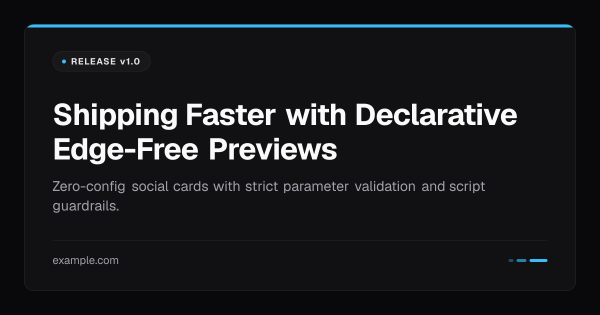
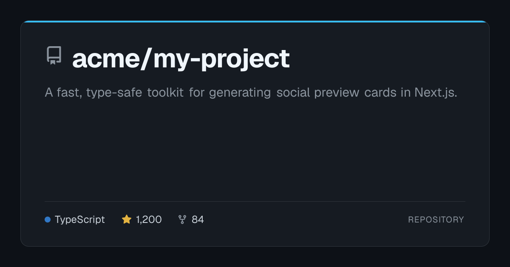
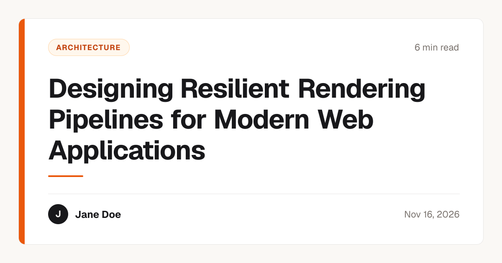
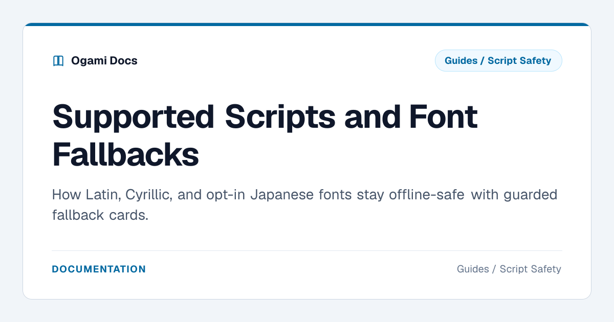
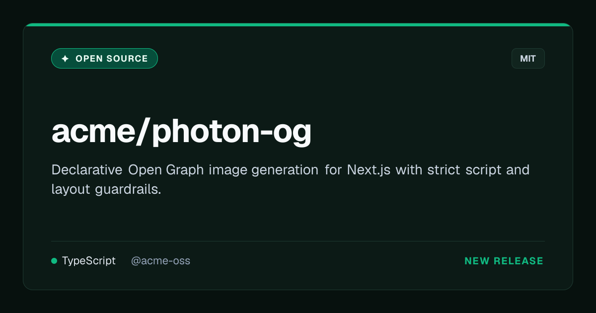
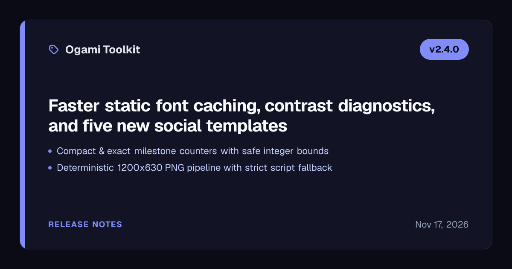
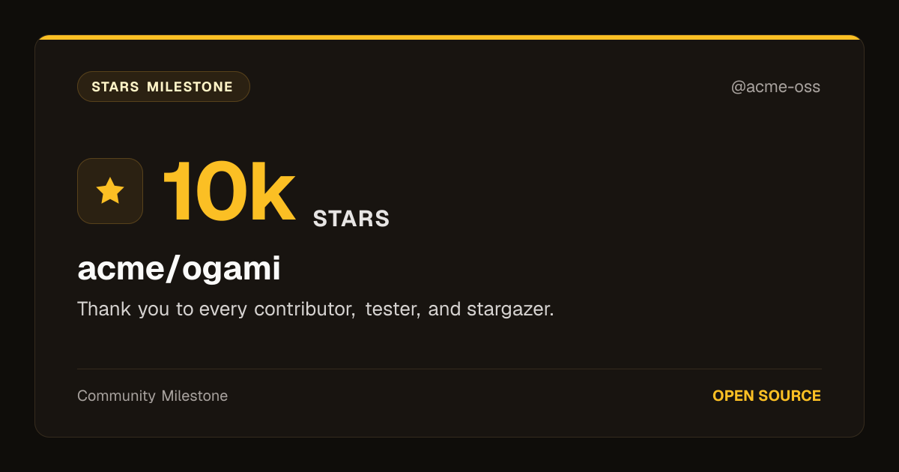
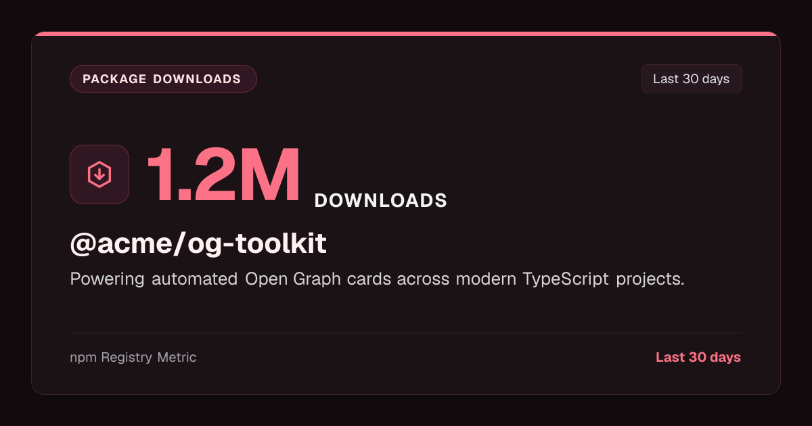
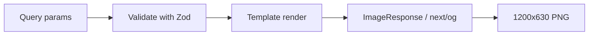

<div align="center">

# Ogami

**Next.js-first, code-first, installable OG template registry with guardrails so cards cannot look broken.**

[](https://github.com/arpitneewaliya/ogami/actions/workflows/ci.yml)
[](LICENSE)

<!-- DEMO_GIF_PLACEHOLDER: Replace the line below with  once recorded -->
> _[Demo GIF placeholder — recording coming soon]_

</div>

```bash
npx shadcn@latest add https://ogami-toolkit.vercel.app/r/github-repo.json
```

<div align="center">

[Live Gallery](https://ogami-toolkit.vercel.app) · [Playground](https://ogami-toolkit.vercel.app/playground) · [Docs](https://ogami-toolkit.vercel.app/docs) · [Contributing](CONTRIBUTING.md)

</div>

## Why Ogami

- **Code-first:** Every template is a single TypeScript/React file with inline styles and a Zod parameter schema — not a drag-and-drop web editor.
- **You own the files:** Templates install directly into your repo via the shadcn registry format (`components/ogami/<id>.tsx` and `lib/ogami/*`), with no `shadcn init`, no `components.json`, and no wrapper package lock-in.
- **Guardrails built in:** Automatic title fitting (`autoFit`), WCAG contrast diagnostics, sourced platform crop overlays, and script safety so cards do not break or crash in production.
- **Stateless:** No accounts, no database, and no stored user data. Installed templates render PNGs on your own Next.js server.

## Templates (8)

All 8 templates render `1200×630` PNGs using pre-verified sample payloads:

| | |
| :---: | :---: |
| <br>**Minimal Tech** (`minimal-tech`)<br>Clean dark-mode announcement card for developer tools, releases, and docs. | <br>**GitHub Repo** (`github-repo`)<br>Repository card with inline repo, star, and fork icons and language indicator. |
| <br>**Blog Post** (`blog-post`)<br>Warm editorial card for articles, essays, and technical blog posts. | <br>**Docs Page** (`docs-page`)<br>Crisp light-mode documentation card with section breadcrumb, title, and summary. |
| <br>**Repo Launch** (`repo-launch`)<br>Open-source repository launch card with stack badge, license pill, and tagline. | <br>**Release** (`release`)<br>Version announcement card with semver pill, release headline, and highlights. |
| <br>**Stars Milestone** (`stars-milestone`)<br>Repository star milestone card with compact or exact formatting and star badge. | <br>**npm Downloads Milestone** (`npm-downloads-milestone`)<br>Package download milestone card with compact or exact counter and cube icon. |

## Quick Start

Requires Next.js (App Router) and Zod 4 (`npm install zod@^4` if your project is on Zod 3).

### 1. Install a template

```bash
npx shadcn@latest add https://ogami-toolkit.vercel.app/r/github-repo.json
```

Files are copied to `components/ogami/<id>.tsx` and `lib/ogami/*` (or `src/components/ogami/<id>.tsx` and `src/lib/ogami/*` in `--src-dir` projects), adding `zod@^4.0.0` and `geist@^1.9.2`. Imports assume the default `@/*` path alias.

### 2. Add `/api/og/route.tsx`

Create `app/api/og/route.tsx` (or `src/app/api/og/route.tsx`):

```tsx
import type { NextRequest } from "next/server";
import githubRepoTemplate from "@/components/ogami/github-repo";
import {
  extractTemplateParamsFromSearchParams,
  type RegisteredTemplate,
} from "@/lib/ogami/define-template";
import { TemplateValidationError, renderTemplate } from "@/lib/ogami/render";

const templates: Record<string, RegisteredTemplate> = {
  [githubRepoTemplate.id]: githubRepoTemplate,
};

export async function GET(request: NextRequest): Promise<Response> {
  const searchParams = request.nextUrl.searchParams;
  const templateId =
    searchParams.get("template")?.trim() || githubRepoTemplate.id;
  const template = templates[templateId];

  if (!template) {
    return Response.json(
      {
        error: `Unknown template "${templateId}".`,
        availableTemplates: Object.keys(templates),
      },
      { status: 404, headers: { "cache-control": "no-store" } },
    );
  }

  const rawParams = extractTemplateParamsFromSearchParams(
    searchParams,
    template,
  );
  const result = await renderTemplate(template, rawParams);

  if (!result.ok) {
    if (result.error instanceof TemplateValidationError) {
      return Response.json(
        { error: "Invalid template parameters.", issues: result.error.issues },
        { status: 400, headers: { "cache-control": "no-store" } },
      );
    }
    return Response.json(
      { error: result.error.message },
      { status: 400, headers: { "cache-control": "no-store" } },
    );
  }

  return result.response;
}
```

### 3. Use it in `generateMetadata` (or `opengraph-image.tsx`)

```tsx
import type { Metadata } from "next";

export function generateMetadata(): Metadata {
  const ogUrl =
    "/api/og?template=github-repo&name=acme%2Fogami&language=TypeScript&stars=1200";

  return {
    openGraph: {
      images: [{ url: ogUrl, width: 1200, height: 630 }],
    },
    twitter: {
      card: "summary_large_image",
      images: [ogUrl],
    },
  };
}
```

For a fixed per-route image, call `renderTemplate(template, params)` directly from `opengraph-image.tsx` and return `result.response` (without exporting `runtime`). See [Quick Start](content/docs/quick-start.md) for `outputFileTracingIncludes` and full setup notes.

## Features & Guardrails

- **`autoFit`:** Scales headline font sizes down based on width and line budgets so long strings fit without clipping.
- **Contrast checker:** The [Playground](https://ogami-toolkit.vercel.app/playground) checks WCAG contrast (`4.5:1` normal text, `3:1` large text) for color pairs declared in each template's `meta.json`, including live color inputs.
- **Sourced platform crop overlays:** Overlays in the playground show crop framing for LinkedIn, Facebook, Discord, and X (marked unverified using an archived snapshot after X removed its live cards docs), with source URLs and check dates in [registry/lib/platforms.ts](registry/lib/platforms.ts). Slack and WhatsApp have no official crop spec.
- **Script safety:** **Latin and Cyrillic** are supported out of the box (`Geist-Regular.ttf` and `Geist-Bold.ttf`). **Japanese** (Hiragana, Katakana, JIS Kanji) is supported via the opt-in `NotoSansJP-Regular.ttf` font pack ([Fonts](content/docs/fonts.md)). **Devanagari, Arabic, Hangul, and Simplified Chinese** (along with Greek, Hebrew, and Thai) are unsupported: instead of crashing or rendering misspelled text, `/api/og` serves a safe fallback card (`200 image/png`, `Cache-Control: no-store`, `X-Ogami-Fallback: true`) containing none of the unsupported text. Emoji are stripped by default (`X-Ogami-Warnings`) so Satori does not fetch remote Twemoji assets. See [Supported Scripts](content/docs/supported-scripts.md).

## How It Works



Ogami runs on Next.js's default **Node.js runtime** (do not export `runtime`, keeping compatibility with `cacheComponents`) and reads `.ttf` fonts from disk via `fs.readFile`. Normal cards return `Cache-Control: public, max-age=86400, s-maxage=604800, stale-while-revalidate=86400`; fallback cards and `400`/`404` responses return `Cache-Control: no-store`.

## Writing a Template

Templates live in `registry/templates/<id>/` and use `defineTemplate` (see [How to Write a Template](content/docs/writing-templates.md) and [Satori Rules](content/docs/satori-rules.md)):

```tsx
import { z } from "zod";
import { defineTemplate } from "../../lib/define-template";

export const params = z.object({
  title: z.string().min(1).max(80),
  subtitle: z.string().max(140).default(""),
  accentColor: z
    .string()
    .max(7)
    .regex(/^#[0-9a-fA-F]{6}$/)
    .default("#38bdf8"),
});

export default defineTemplate({
  id: "my-card",
  name: "My Card",
  description: "Short one-line description for the gallery and registry.",
  params,
  sample: {
    title: "Hello from Ogami",
    subtitle: "Declarative Open Graph images with strict parameter caps.",
    accentColor: "#38bdf8",
  },
  render: (p, ctx) => {
    const fittedTitle = ctx.autoFit(p.title, {
      maxWidth: 960,
      maxLines: 2,
      maxFontSize: 64,
      minFontSize: 32,
      lineHeight: 1.15,
    });
    const fontFamily = Array.from(new Set(ctx.fonts.map((f) => f.name))).join(", ");

    return (
      <div
        style={{
          display: "flex",
          flexDirection: "column",
          width: "100%",
          height: "100%",
          padding: 56,
          backgroundColor: "#09090b",
          color: "#fafafa",
          fontFamily,
        }}
      >
        <div
          style={{
            display: "flex",
            fontSize: fittedTitle.fontSize,
            fontWeight: 700,
            lineHeight: fittedTitle.lineHeight,
          }}
        >
          {p.title}
        </div>
      </div>
    );
  },
});
```

## Contributing

**One contribution = one template folder.** Add `registry/templates/<id>/template.tsx` and `meta.json`, then run `npm run templates:sync`, `npm run preview:build`, and `npm run registry:build`. See [CONTRIBUTING.md](CONTRIBUTING.md) for the boilerplate, Satori rules, and CI checklist.

## Project Status & Roadmap

Ogami is **early (v0)**. Local builds, fresh `create-next-app` installs, and GitHub Actions Linux CI (`Node 22` and `Node 26`) are verified; live Vercel production font tracing (`outputFileTracingIncludes`) and serverless cold starts are tracked in [docs/launch-checklist.md](docs/launch-checklist.md).

**Deferred from v1:** complex script shaping (Devanagari/Indic, Arabic/RTL), a custom CLI, live data fetching (such as GitHub API stats), a visual drag-and-drop editor, accounts/databases, non-Next.js frameworks, and Edge runtime support.

## License & Credits

MIT License — see [LICENSE](LICENSE).

Built with [Satori](https://github.com/vercel/satori) / `next/og`, the [shadcn registry format](https://ui.shadcn.com/docs/registry), and [Geist](https://vercel.com/font) (SIL Open Font License 1.1).
